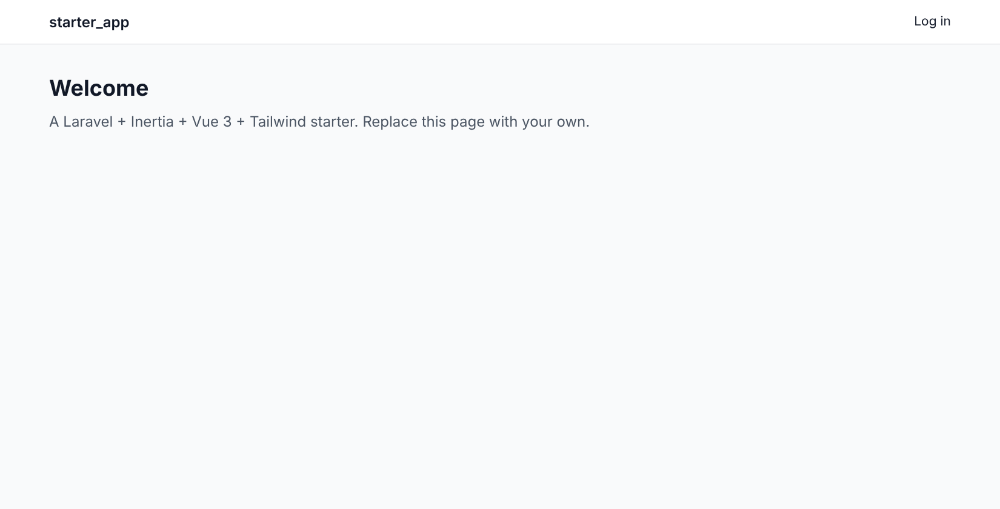
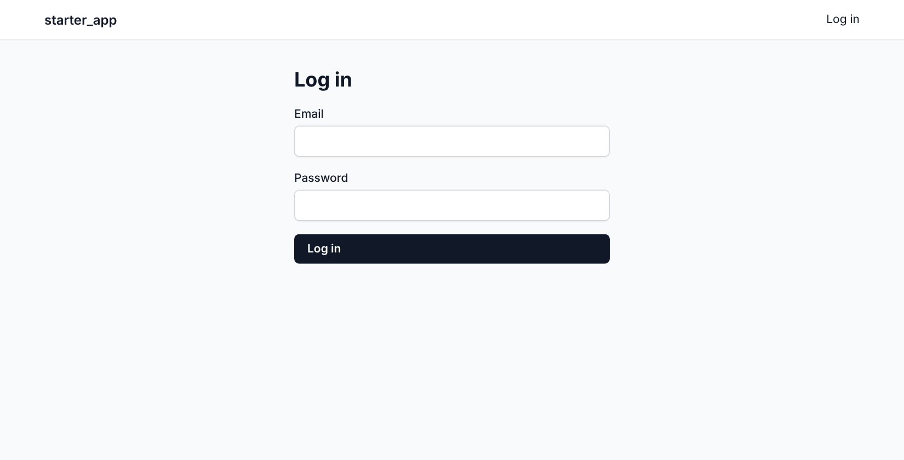
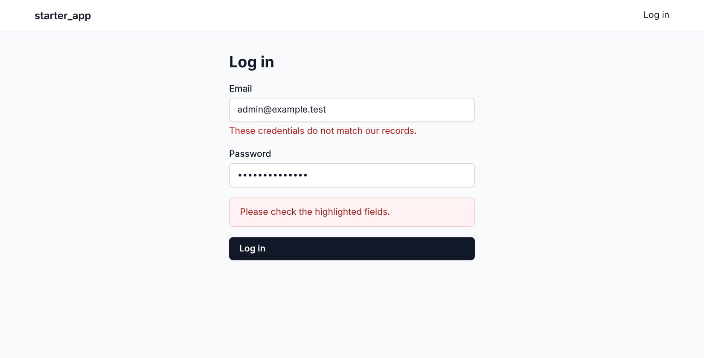
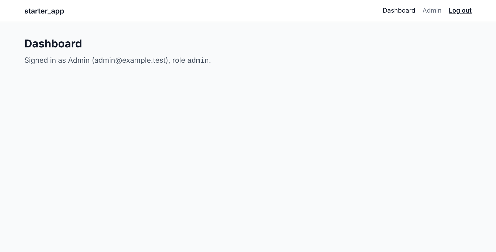

# starter-app

A starter template for **Laravel 12 + Inertia + Vue 3 + Tailwind**: server-side
routing with a Vue front end, session authentication with a rate-limited login,
one JSON error contract, least-privilege Postgres roles, an embeddable-widget
build, Pest + Larastan + Pint, Vitest, Docker (dev and production) and GitHub
Actions CI with security scanning.

It carries no domain code. Everything here is infrastructure you would
otherwise rebuild on day one.

## Screenshots









_Real captures from a local run (PHP 8.3, PostgreSQL with the runtime/migrator role split, Redis, seeded admin account), driven with Playwright._

## What is in it

| Area | Contents |
|---|---|
| App core | `bootstrap/app.php` (trusted proxies, exception rendering), `HandleInertiaRequests` (shared `auth`, `csrfToken`, `appName`), `AuthenticatedSessionController` (login with session regeneration and exponential lockout, logout), `GET /api/v1/me`, `/up` health check |
| Error handling | `App\Exceptions\ApiExceptionRenderer` (the `{error, fields}` JSON contract), `App\Exceptions\InertiaErrorPage` (Inertia `Error` page for 403/404/500/503 outside debug mode) |
| Response helpers | `RespondsWithJson` on the base controller: `ok()`, `error()`, `paginated()`, `perPage()` |
| Front end | Inertia + Vue 3 + Tailwind 3 (`resources/js`), `lib/api.js` (`postJson`), `composables/useFormErrors.js`, the shared components below, `AppLayout`, pages: Welcome, Login, Dashboard, Error |
| Widget | A standalone embeddable bundle (`resources/js/widget`, `vite.widget.config.js` -> `public/widget.js`) for third-party pages, with `public/embed-example.html` |
| Database | Two Postgres connections: `pgsql` (runtime role, no `BYPASSRLS`) and `pgsql_migrator` (owner role). Bootstrap SQL in `docker/postgres/init` |
| Tests | Pest 4 (Feature: auth flow, CSRF, rate limit, trusted proxies, error contract, pagination helper; Browser: login UI via Playwright), Vitest (components, composable, API helper, pages) |
| Tooling | Pint, Larastan (level 8), ESLint, `.editorconfig`, Docker (`runtime`, `test`, production `app` + `web` with Caddy), CI |
| Governance | MIT `LICENSE`, `SECURITY.md`, `CONTRIBUTING.md`, `CODE_OF_CONDUCT.md`, Dependabot, issue/PR templates, `osv-scanner.toml` (dated exceptions only) and an empty `.gitleaksignore`, `scaffold-memory-pack.sh`, empty `docs/project-memory` |

### Shared components (`resources/js/Components/`)

All are covered by `tests/js/components.test.js`.

| Component | Purpose |
|---|---|
| `Button` | `primary`, `secondary` and `link` variants; `type` defaults to `button` |
| `TextInput` | Labelled `v-model` input with a field error (`:error="fieldError('email')"` from `useFormErrors`) |
| `FormField` | Label + error wrapper around any control (select, textarea) |
| `Alert` | Error (`role="alert"`) or info (`role="status"`) banner |
| `Spinner` | Accessible loading indicator |
| `EmptyState` | Title, description and an actions slot |
| `Modal` | Dialog with Escape / backdrop / close-button dismissal; the parent owns `open` |
| `Pagination` | Previous / next for a paginated `meta` object (hidden for a single page) |
| `DataTable` | Columns + rows, `#cell-<key>` slots, spinner while loading, empty state |

`Layouts/AppLayout.vue` is the app shell and `Pages/Error.vue` the error page.
A list endpoint returns
`$this->paginated($query->paginate($this->perPage($request)))`, which is
`{ data, meta }`; feed `data` to `DataTable` and `meta` to `Pagination`.

## Getting started

Requirements: PHP 8.3+, Composer, Node 22+, Docker (or local Postgres 16+ and
Redis).

```bash
# 1. Name your project (replaces the starter_app / starter-app / StarterApp placeholders)
./rename.sh my-project your-vendor

# 2. Services (creates the Postgres roles and both databases on first boot)
docker compose up -d postgres redis

# 3. Backend
composer install
cp .env.example .env
php artisan key:generate
php artisan migrate --database=pgsql_migrator
php artisan db:seed        # local only: admin@example.test / password
php artisan serve --host=localhost

# 4. Front end (second terminal)
npm ci && npm run dev
```

Open <http://localhost:8000>. Use `localhost` consistently: cookies are scoped
by hostname.

Or run everything in containers: `docker compose up --build`.

## Day-to-day commands

```bash
composer ci:check        # Pint + Larastan + Pest, browser tests excluded (what CI gates on)
composer test:e2e        # browser tests: needs `npm run build` and `npx playwright install chromium`
composer lint:fix        # apply Pint

npm run lint             # ESLint
npm test                 # Vitest
npm run build            # app bundle and widget bundle
```

## Conventions worth knowing

- **Error contract.** A request under `api/*`, or one that expects JSON, gets
  `{"error": "CODE"}`, plus `"fields": {...}` for `VALIDATION_FAILED` (422).
  Clients branch on the code. See `app/Exceptions/ApiExceptionRenderer.php`
  for the list. Browser requests get the Inertia `Error` page instead (unless
  `APP_DEBUG=true`). `resources/js/lib/api.js` and `useFormErrors` consume
  exactly this shape.
- **Auth.** Session authentication on the `web` middleware group. The login
  page posts JSON with the shared `csrfToken`; failures lock the next attempt
  out for 2, 4, 8, ... seconds (capped at 5 minutes) per email and IP. API
  routes that need the session add the `web` middleware group.
- **Database roles.** The app connects as a non-owner role; migrations and
  seeders use `pgsql_migrator`. Never put the migrator credential in the
  long-running runtime environment.
- **Tests use real Postgres, never SQLite.** The role split has no SQLite
  equivalent. `tests/Concerns/RefreshesDatabaseAsMigrator.php` routes only the
  schema bootstrap through the owner role.
- **Behind a proxy**, set `TRUSTED_PROXIES` to the proxy's address or CIDR
  (never `*`), or `$request->ip()` is the proxy for everyone and IP-keyed
  limits share one bucket.

## Production

`docker-compose.prod.yml` builds PHP-FPM (`app`) behind Caddy (`web`), with a
`worker` and a one-shot `migrate` job. Postgres and Redis are expected to be
external; see the comments at the top of the file.

## Project layout

```
app/                 Application code (Exceptions/, Http/Concerns/, Http/Controllers/Auth/)
config/              Framework config, incl. the two database connections
database/            Migrations, factories, seeders
docker/              Dockerfiles, Caddyfile, Postgres bootstrap SQL
resources/js/        Inertia app: Pages/, Layouts/, Components/, lib/, composables/, widget/
tests/               Feature/, Browser/, js/ (Vitest), Concerns/
docs/project-memory/ Empty project-memory scaffold
```

## License

MIT. Replace the placeholders in [`LICENSE`](LICENSE) before publishing.
